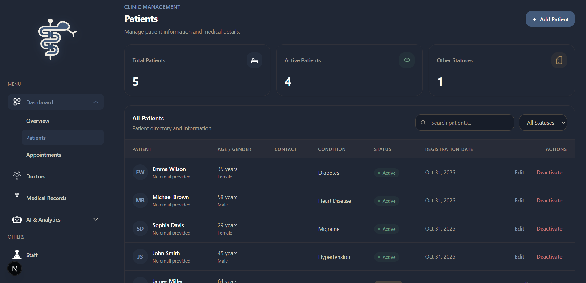
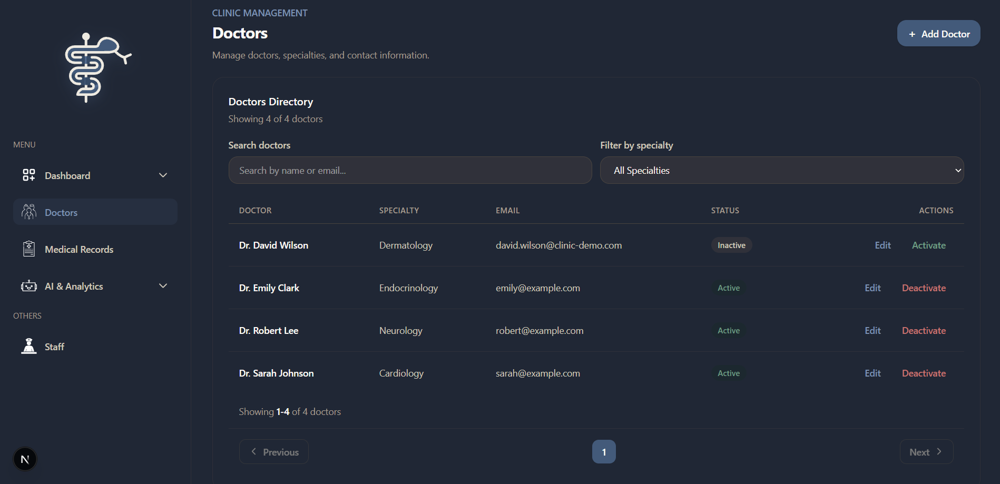
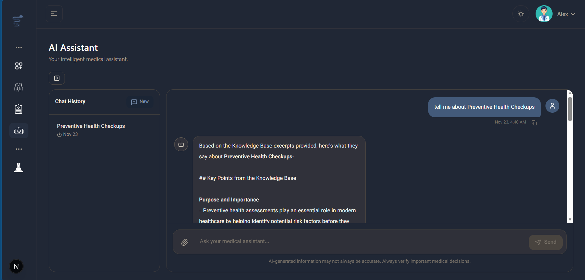
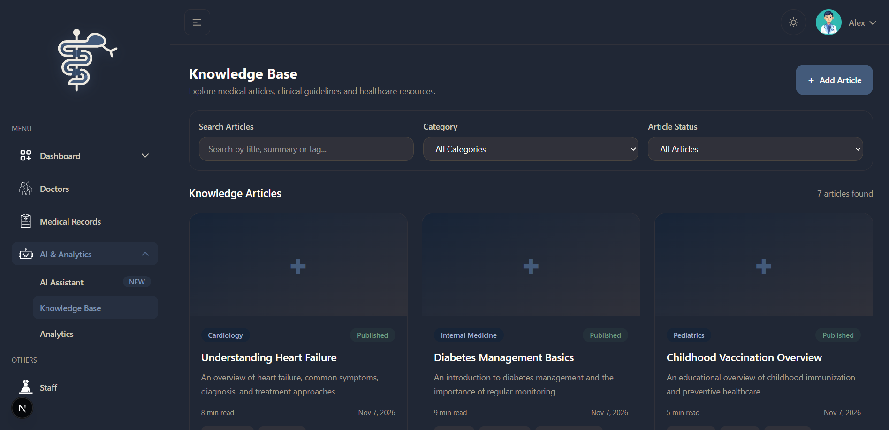
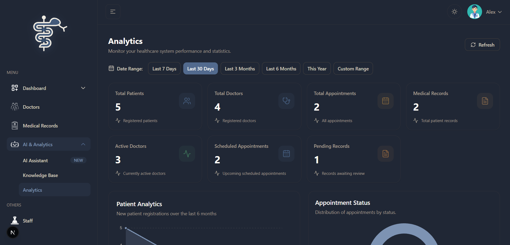

<div align="center">

# 🏥 Medical Dashboard

### A Modern Healthcare Management Platform with an AI-Powered Assistant

A full-stack medical dashboard designed to streamline healthcare operations, manage clinical information, and provide AI-assisted insights through a secure, role-aware environment.

[](https://nextjs.org/)
[](https://react.dev/)
[](https://www.typescriptlang.org/)
[](https://www.python.org/)
[](https://fastapi.tiangolo.com/)
[](https://supabase.com/)
[](https://www.docker.com/)

</div>

---

## 📖 Overview

Medical Dashboard is a full-stack healthcare management application that brings essential clinical workflows into a unified, modern interface.

The platform combines a feature-based Next.js frontend, a Python/FastAPI backend, Supabase-powered authentication and data storage, and an AI assistant capable of combining knowledge-base retrieval with external web search.

It is designed around two primary user roles:

- **Admin:** Access to administrative functionality, including management operations and persistent AI conversation history.
- **Demo User:** A restricted, read-only experience intended for demonstrations and exploration.

The application uses a modular architecture to keep frontend features, backend services, and integrations maintainable and independently extensible.

> **Project status:** Dockerized application with frontend and backend test suites. Designed as a demonstration and development project, not a certified clinical system.

---

## ✨ Features

### 📊 Healthcare Dashboard

- Centralized dashboard overview.
- Clinical data visualization and analytics.
- Responsive application layout.
- Light and dark theme support.
- Modern healthcare-focused UI.

### 👥 Patient Management

- Patient directory and profile views.
- Patient-related information management.
- Structured clinical data organization.

### 🩺 Clinical Operations

- Doctor directory.
- Appointment management.
- Medical records.
- Staff directory.
- User profile and settings.

### 📚 Knowledge Base

- Organized knowledge categories.
- Knowledge article management.
- Structured information for AI-assisted retrieval.

### 🤖 AI Assistant

An integrated AI assistant designed to support healthcare-related information workflows.

Key capabilities:

- Natural-language conversations.
- Retrieval-Augmented Generation (RAG).
- Knowledge-base semantic search.
- External web search through Tavily.
- Source references in AI responses.
- Conversation history and management.
- Automatic conversation titles without additional LLM calls.
- File uploads for supported document formats.
- Role-aware tool access.
- Input and output safety checks.
- Prompt-injection protection.
- PII detection and redaction.

**AI tool permissions:**

| Capability | Admin | Demo User |
|---|---:|---:|
| AI Chat | ✅ | ✅ |
| Knowledge Base Retrieval | ✅ | ✅ |
| External Web Search | ✅ | ✅ |
| Database Tools | ✅ | ❌ |
| Persistent Conversation History | ✅ | ❌ |
| File Upload | ✅ | ❌ |

AI-generated content is informational and should not be considered a medical diagnosis, treatment recommendation, or substitute for professional clinical judgment.

---

## Screenshots

### Patients


### Doctors


### AI Assistant


### Knowledge Base


### Analytics


## 🏗️ Architecture

The project follows a feature-based architecture with separate frontend and backend applications.

```text
medical-dashboard/
│
├── apps/
│   │
│   ├── frontend/
│   │   ├── src/
│   │   │   ├── app/
│   │   │   ├── components/
│   │   │   ├── context/
│   │   │   ├── features/
│   │   │   ├── layout/
│   │   │   ├── lib/
│   │   │   ├── shared/
│   │   │   └── tests/
│   │   │
│   │   ├── public/
│   │   ├── Dockerfile
│   │   └── next.config.ts
│   │
│   └── backend-ai/
│       ├── app/
│       │   ├── core/
│       │   │   ├── dependencies/
│       │   │   └── providers/
│       │   │
│       │   ├── features/
│       │   │   └── ai_assistant/
│       │   │       ├── api/
│       │   │       ├── prompts/
│       │   │       ├── repositories/
│       │   │       ├── schemas/
│       │   │       └── services/
│       │   │
│       │   ├── shared/
│       │   └── main.py
│       │
│       ├── tests/
│       ├── scripts/
│       ├── Dockerfile
│       ├── Pipfile
│       └── .env.example
│
├── Dockerfile
├── package.json
├── vitest.config.ts
└── README.md
```

### Frontend

The frontend is organized by application features rather than by technical file type.

Each feature can contain its own components, API functions, hooks, types, and related logic.

### Backend

The backend uses a modular FastAPI architecture.

- `core/`: Application configuration, providers, dependencies, authentication, and shared infrastructure.
- `features/`: Business features and their associated APIs and services.
- `shared/`: Reusable backend functionality.
- `tests/`: Backend automated tests.

### Data Flow

```text
                 ┌─────────────────────┐
                 │     Web Browser     │
                 └──────────┬──────────┘
                            │
                            ▼
                 ┌─────────────────────┐
                 │  Next.js Frontend   │
                 │   React / TypeScript│
                 └──────────┬──────────┘
                            │
                  ┌─────────┴─────────┐
                  │                   │
                  ▼                   ▼
          ┌──────────────┐    ┌──────────────┐
          │   Supabase   │    │  FastAPI AI  │
          │ Auth & Data  │    │    Backend   │
          └──────────────┘    └──────┬───────┘
                                     │
                         ┌───────────┼───────────┐
                         │           │           │
                         ▼           ▼           ▼
                    OpenRouter     Jina       Tavily
                    LLM Provider   Embeddings  Web Search
```

---

## 🛠️ Technology Stack

### Frontend

| Technology | Purpose |
|---|---|
| Next.js 16 | React application framework |
| React 19 | UI development |
| TypeScript | Type safety |
| Tailwind CSS 4 | Styling |
| TanStack Query | Server-state management |
| Supabase JS | Authentication and database access |
| React Hook Form | Form management |
| Zod | Schema validation |
| Chart.js | Data visualization |
| FullCalendar | Calendar and appointment interfaces |
| Vitest | Frontend testing |
| React Testing Library | Component and hook testing |

### Backend

| Technology | Purpose |
|---|---|
| Python 3.12 | Backend runtime |
| FastAPI | REST API framework |
| Pydantic | Data validation and settings |
| Supabase | Authentication and database integration |
| OpenAI Python SDK | LLM provider integration |
| OpenRouter | AI model access |
| Jina AI | Text embeddings |
| Tavily | External web search |
| SlowAPI | API rate limiting |
| Pytest | Backend testing |

### Infrastructure

- Docker
- Multi-stage frontend image build
- Non-root container users
- Next.js standalone production output
- Environment-based configuration

---

## 🚀 Getting Started

### Prerequisites

Make sure you have the following installed:

- Node.js 22 or later
- npm
- Python 3.12
- Pipenv
- Docker (for containerized execution)
- A Supabase project
- API credentials for the AI services you intend to use

### 1. Clone the Repository

```bash
git clone https://github.com/owlnotes666-dot/1.git

cd 1
```

### 2. Configure the Frontend

Create your frontend environment file:

```bash
cp apps/frontend/.env.example apps/frontend/.env.local
```

Configure the following variables:

```env
NEXT_PUBLIC_SUPABASE_URL=your_supabase_project_url
NEXT_PUBLIC_SUPABASE_ANON_KEY=your_supabase_anon_key

NEXT_PUBLIC_API_URL=http://localhost:8000
```

`NEXT_PUBLIC_API_URL` must point to the FastAPI backend.

### 3. Configure the Backend

Navigate to the backend directory:

```bash
cd apps/backend-ai
```

Create the environment file:

```bash
cp .env.example .env
```

Configure the backend environment:

```env
APP_NAME=Medical Dashboard AI
APP_ENV=development
API_V1_PREFIX=/api/v1

FRONTEND_ORIGIN=http://localhost:3000

AI_PROVIDER=openrouter
AI_MODEL=nvidia/nemotron-3-ultra-550b-a55b:free

OPENROUTER_API_KEY=your_openrouter_api_key
JINA_API_KEY=your_jina_api_key
TAVILY_API_KEY=your_tavily_api_key

SUPABASE_URL=your_supabase_project_url
SUPABASE_ANON_KEY=your_supabase_anon_key
```

Optional Hugging Face configuration:

```env
HF_TOKEN=your_huggingface_token
```

Use the provider and model configuration supported by your backend setup.

Never commit real API keys, credentials, or `.env` files to version control.

### 4. Install Dependencies

From the repository root:

```bash
npm install
```

For the backend:

```bash
cd apps/backend-ai

pipenv install --dev
```

### 5. Run the Backend

From `apps/backend-ai`:

```bash
pipenv run uvicorn app.main:app --reload --host 0.0.0.0 --port 8000
```

Backend available at:

```text
http://localhost:8000
```

API documentation:

```text
http://localhost:8000/docs
```

Health endpoint:

```text
http://localhost:8000/api/v1/health
```

### 6. Run the Frontend

From the repository root:

```bash
npm run dev
```

Frontend available at:

```text
http://localhost:3000
```

---

## 🐳 Docker Deployment

The project includes dedicated Docker configurations for both frontend and backend applications.

The frontend uses a multi-stage build with Next.js standalone output to produce a production-oriented image.

The backend runs FastAPI with Uvicorn inside a Python container.

### Build Docker Images

Build the frontend image:

```bash
docker build -t medical-dashboard-frontend:local .
```

Build the backend image:

```bash
docker build -f apps/backend-ai/Dockerfile -t medical-dashboard-ai:local apps/backend-ai
```

### Run the Applications

Make sure the backend environment file exists at:

```text
apps/backend-ai/.env
```

Start the frontend container:

```bash
docker run --rm -p 3000:3000 medical-dashboard-frontend:local
```

Start the backend container:

```bash
docker run --rm --env-file apps/backend-ai/.env -p 8000:8000 medical-dashboard-ai:local
```

Run both commands in separate terminals.

### Access the Applications

| Service | URL |
|---|---|
| Frontend | http://localhost:3000 |
| Backend | http://localhost:8000 |
| API Documentation | http://localhost:8000/docs |
| Backend Health Check | http://localhost:8000/api/v1/health |

### Docker Configuration Notes

- The frontend image must be built with the correct public environment variables, including `NEXT_PUBLIC_SUPABASE_URL`, `NEXT_PUBLIC_SUPABASE_ANON_KEY`, and `NEXT_PUBLIC_API_URL`.
- `NEXT_PUBLIC_API_URL` is embedded into the frontend build. Configure it before building the image.
- The backend requires its environment variables through `apps/backend-ai/.env`.
- `FRONTEND_ORIGIN` must match the frontend origin to satisfy backend CORS configuration.
- When deploying outside localhost, configure the frontend API URL using an address accessible by the user's browser.
- Supabase and external AI provider credentials must be configured independently.

The frontend and backend images are built and run separately. A Docker Compose configuration is not currently included in this repository.

---

## 🗄️ Database & Authentication

The application uses Supabase for authentication and database operations.

Medical application data is organized under the dedicated `medical` schema.

The main data entities include:

- Patients
- Doctors
- Appointments
- Medical Records
- Staff
- Profiles
- Knowledge Categories
- Knowledge Articles

### Access Control

The application distinguishes between Admin and Demo users.

Row Level Security (RLS) is enabled for the medical data tables.

The intended access model is:

- Admin users have administrative data permissions.
- Demo users have read-only access to demonstration data.
- AI backend tools are restricted according to the authenticated user's role.

The backend validates Supabase access tokens before handling protected AI endpoints.

> Database schema, authentication configuration, and RLS policies must be configured in your own Supabase project before running the application.

---

## 🤖 AI Assistant Architecture

The AI assistant combines several services into a controlled tool-based workflow.

### Language Model

OpenRouter is used as the primary model gateway.

The configured default model is:

```text
nvidia/nemotron-3-ultra-550b-a55b:free
```

Model availability and free-tier quotas are controlled by the provider and may change.

### Retrieval-Augmented Generation

The RAG workflow uses Jina embeddings to support semantic retrieval from the knowledge base.

Relevant knowledge-base content can be provided to the language model as contextual information.

### Web Search

Tavily provides external web search capabilities.

Search results are normalized and presented as external sources rather than being treated as trusted internal knowledge.

### Safety & Security

The AI request pipeline includes:

- Input validation.
- PII detection and redaction.
- Prompt-injection detection and protection.
- Controlled tool execution.
- Output safety checks.
- Role-based tool permissions.
- API rate limiting.

External search content is treated as untrusted input.

### Conversation Management

Admin conversations are stored persistently and can be listed, resumed, and deleted.

Demo conversations are maintained only in frontend memory and are not permanently stored.

Conversation titles are generated deterministically from the initial message rather than requiring another LLM request.

File uploads are restricted to the Admin role and handled using temporary in-memory storage with a configured expiration period.

---

## 🧪 Testing

The project includes automated frontend and backend tests.

### Frontend Tests

Run all frontend tests:

```bash
npm run test:run
```

Run tests in watch mode:

```bash
npm test
```

Run frontend linting:

```bash
npm run lint
```

Run TypeScript validation:

```bash
npx tsc --noEmit
```

The frontend test stack includes:

- Vitest
- React Testing Library
- JSDOM
- Testing Library Jest DOM matchers

### Backend Tests

From `apps/backend-ai`:

```bash
pipenv run pytest -v
```

Run a focused test module:

```bash
pipenv run pytest tests/test_ai_assistant_api.py -v
```

The backend test suite covers API behavior, AI assistant services, dependencies, conversation management, and external integrations.

---

## 🔐 Security Considerations

Security is an important part of the application architecture.

- Supabase authentication is used for protected application access.
- Row Level Security is enabled for medical data tables.
- Backend endpoints validate authenticated requests.
- AI tool permissions depend on the authenticated role.
- Rate limiting protects the AI chat endpoint.
- Sensitive user information is handled through PII detection and redaction.
- External search content is treated as untrusted.
- Docker containers use non-root users.
- Secrets should be provided through environment variables.

**Important:** This project is intended for demonstration and development purposes. Do not use real patient information or production clinical data without appropriate security, privacy, compliance, and operational reviews.

---

## ⚙️ Available Scripts

From the repository root:

| Command | Description |
|---|---|
| `npm run dev` | Start the Next.js development server |
| `npm run build` | Build the frontend for production |
| `npm run start` | Start the production frontend server |
| `npm run lint` | Run ESLint |
| `npm run test:run` | Run frontend tests once |
| `npm test` | Run frontend tests in watch mode |
| `npm run test:ui` | Open the Vitest UI |

---

## 🗺️ Application Modules

The dashboard is organized around the following application areas:

| Module | Description |
|---|---|
| Dashboard | Healthcare overview and analytics |
| Patients | Patient directory and information |
| Appointments | Appointment workflows |
| Doctors | Doctor directory |
| Medical Records | Clinical record management |
| AI Assistant | AI-powered conversational interface |
| Knowledge Base | Structured knowledge resources |
| Analytics | Data visualization and insights |
| Staff | Staff directory |
| Settings | Application preferences |
| Profile | User profile |

---

## 📌 Current Limitations

- AI model availability depends on the configured provider.
- Free-tier AI services may have usage limits and availability changes.
- Demo conversations are intentionally ephemeral.
- Demo users have restricted permissions.
- File uploads are temporary and are not intended as permanent document storage.
- The project does not provide certified clinical decision support.
- Database initialization and Supabase policies must be configured separately.
- Docker images are provided for each application; orchestration with Docker Compose is not currently included.

---

## 🔮 Future Improvements

Potential areas for further development include:

- Expanded automated test coverage.
- CI/CD automation.
- Production deployment configuration.
- Improved observability and monitoring.
- Additional healthcare workflows.
- Enhanced AI evaluation and safety testing.
- More comprehensive API documentation.
- Container orchestration configuration.

---

## 🤝 Contributing

Contributions, suggestions, and issue reports are welcome.

1. Fork the repository.
2. Create a feature branch.
3. Implement your changes.
4. Run the relevant tests.
5. Submit a pull request with a clear description.

Please avoid committing secrets, environment files, or sensitive healthcare information.

---

## ⚠️ Disclaimer

Medical Dashboard is a software demonstration project.

It is not a certified medical device, electronic health record system, or clinical decision-support system. AI-generated information may be inaccurate or incomplete and must not replace qualified healthcare professionals.

Use synthetic or non-sensitive demonstration data only.

---

<div align="center">

### Built with ❤️ for modern healthcare workflows

**Medical Dashboard — Healthcare Management Meets AI**

</div>
